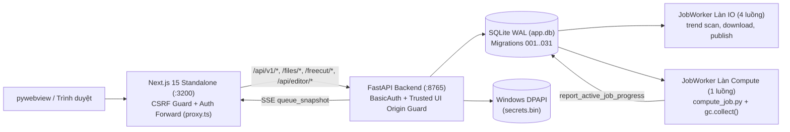
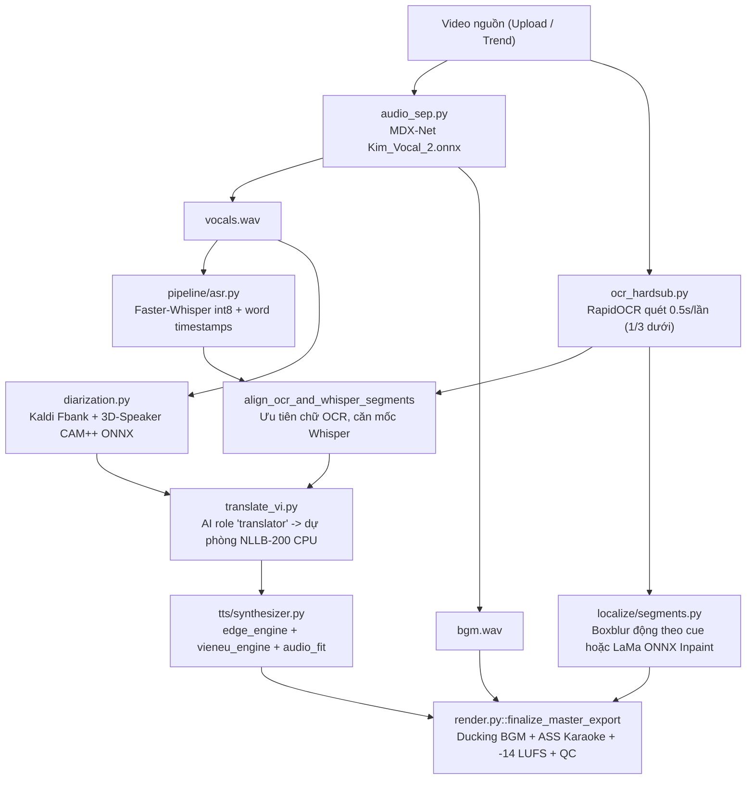

# Tài liệu Tổng kết Bàn giao Kỹ thuật — Video Creator V2 (`2.4.0`)

- **Nhánh bàn giao tích hợp Muse**: `feat/muse-gateway` (phiên bản **`2.4.0`**, phát triển trên nền `feat/v2.3-complete` `89a7661`)
- **Tài liệu đặc tả gốc**: `docs/video-creator-v2-spec.md`
- **Tài liệu tích hợp & PoC Muse Gateway**: `docs/integrations/muse-gateway.md`, `docs/integrations/muse-gateway-poc.md`, bản vá `tools/muse-gateway-patches/0001-vc-hardening.patch`
- **Tài liệu hướng dẫn nhân sự & kiểm tra máy sạch**: `docs/staff-release-notes.md`
- **Hồ sơ kiểm kê & đối chiếu Refactor**: `docs/refactor/baseline.md`, `docs/refactor/v1-inventory.md`
- **Bộ cài Offline `2.4.0` (`feat/muse-gateway`)**: `installer/dist/VideoCreatorV2Setup.exe` (**585.6 MB**, SHA-256: `c29a23c107b4d0f33846cfcb3fd505933f7c063abcd8ceb81eb7870e87fe574e`)
- **Bản sao lưu Bộ cài `2.0.0` (`v2` gốc)**: `installer/dist/VideoCreatorV2Setup_2.0.0_v2.exe` (**596.1 MB**, SHA-256: `0b8b45c6328049ef56c504fa0c7935e6dea536ca3d91dc34caa9a5c5d3c9622d`)
- **Độ phủ Kiểm thử tự động**: **79 tệp test Python** (`pytest -m local` đạt **287 passed, 1 skipped**, `pytest -m models` đạt **4 passed**, cùng smoke test tùy chọn `pytest -m muse_live`) + **3 tệp unit test TypeScript frontend** (`npm test` đạt **10/10 pass**), `320` HTTP/Mount routes được khóa thứ tự bằng `tests/snapshots/routes.json`.

---

## 1. Lịch sử Phát triển các Mốc Bàn giao (`R1 → 2.3.0`)

| Giai đoạn | Commit tiêu biểu | Nội dung chính |
|---|---|---|
| **R1 → R6 (`2.0.0`)** | `90370f7` .. `4974efd` | Hoàn thiện dây chuyền AI CPU thật (MDX-Net, RapidOCR, LaMa ONNX, Faster-Whisper, 3D-Speaker, NLLB-200, VieNeu-TTS v3 Nano, Rembg), render bất đồng bộ SSE `JobProgressBanner`, và bộ cài Windows `.exe` 100% offline vượt qua bài test `PATH=""`. |
| **UI Redesign (`2.1.0`)** | `4fecb7c` | Hệ thống semantic tokens Sáng / Tối / Hệ thống chuẩn WCAG 2.1 AA (`0` mã màu hex cứng trên `web-next/src/`), AppShell gom 5 cụm có `Ctrl+K`, tách mô-đun trang `/localize` và `/settings`. |
| **Wave 0 (`2.2.0`)** | `5fd0c3f` .. `18b4c20` | Khóa snapshot thứ tự 253 route (`test_arch_route_snapshot.py`), cấm import tương đối & `_private` trong `__all__`, tự suy diễn version kiểm thử đóng gói từ `videocreator.__version__`. |
| **Wave 1 (`2.2.0`)** | `a7873cd` .. `9fbdd59` | Vá 6 nhóm lỗi nghiêm trọng: chặn CSRF xuyên cổng Next.js proxy & chuyển tiếp Basic Auth ở chế độ LAN (`proxy.ts` + `auth.py`), giới hạn phục hồi job crash tối đa 3 lần (`031_job_attempts.sql` + `/api/v1/jobs/{id}/retry`), sửa lỗi đọc kép body & `204` trên `apiFetch` (`ApiError`), tạm dừng worker + chặn `PRAGMA user_version` mới hơn + phục hồi job treo khi khôi phục gói `.vcx` (`transfer.py`). |
| **Wave 2 (`2.2.0`)** | `6fe0c42` .. `53e95a7` | Tạo các khối dùng chung backend: `safe_paths.py`, `db_rows.py`, `pipeline/compute_job.py`, `services/{assets,voices_catalog,secret_keys}.py`, `api/v1/uploads.py`; xóa sổ hoàn toàn chiều import ngược từ `api/v1/*` về `api/routes_*`. |
| **Wave 3 (`2.2.0`)** | `cb2b0ca` .. `d0945ba` | Tách 7 cụm module lớn ở backend (100% file dưới 450 dòng): `ai_models/`, `pipeline/asr.py`, `tts/*`, `autopilot/{crud,producers,runner}`, `pipeline/podcast_visuals.py`, `pipeline/workflows/{dag,store,node_runners,executor}`, tách nhỏ `routes_resources.py` và `routes_production.py`. |
| **Wave 4 (`2.2.0`)** | `e728b69` .. `c1dc256` | Mô-đun hóa `lib/api/{types,client}.ts` + `lib/workspace-context.tsx`, bổ sung `hooks/{useApiQuery,useApiMutation,useQueueSnapshot,useLocalStorageState}.ts` (hủy request cũ bằng `AbortController` khi chuyển Workspace), đưa số lệnh `fetch()` thô bên ngoài client/proxy về `0`, tách nhỏ 4 trang lớn (`/approval`, `/characters`, `/welcome`, `/trends` đều dưới 300 dòng). |
| **Wave 5–6 (`2.2.0`)** | `7122121` .. `ed41a2e` | Kiểm kê 24 router V1 (`docs/refactor/v1-inventory.md`), tách gói `api/mounts/` (`/files`, `/freecut`, `/oauth`, `/settings/export|import`, `/ui-unavailable`), cô lập router HTML cũ vào `api/legacy_v1.py`, nâng phiên bản `2.2.0` và đóng gói bộ cài offline. |
| **Hoàn thiện Toàn diện (`2.3.0`)** | `c4633be` .. `89a7661` | Đồng bộ **20/20 trang Next.js** sang `useApiQuery` (`createAbortableQueryRunner`), tách gọn `/novel`, `/batch`, `/videos/[id]` và thêm unit test TypeScript (`npm test`); bổ sung linter AST Python `F821`/`F401` (`test_static_python_lint.py`), nhãn `@pytest.mark.slow` và mẫu GitHub Actions CI (`docs/ci/github-actions-ci.yml`); tách 4 module backend cuối cùng (`ai_images.py` tích hợp **Google GenAI Imagen 3**, `news_extractor.py`, `novel_chapters.py`, `batch_planner.py`); đạt **100% API parity V1→V2** (`270` routes) kèm cờ tắt hẳn V1 (`VIDEOCREATOR_DISABLE_LEGACY_V1=1`). |
| **Tích hợp Muse Gateway Đa luồng (`2.4.0`)** | `cceec6e` .. HEAD | Vá bảo mật `0001-vc-hardening.patch` (`cmdMode='off'`, chặn RCE & rò rỉ `<cwd>`), gói `videocreator.muse_gateway` (client, sidecar, pairing DPAPI, migration `032_muse_gateway.sql`, bộ điều phối đa luồng không chặn worker + webhook HMAC, Storyboard nối cảnh FFmpeg, proxy quản trị ẩn cookie, sao lưu mã hóa `.vcx`), tích hợp Muse Image / Muse TTS / Muse Chat, gắn vào toàn bộ Studio (`waiting_media` + auto-resume), trang `/muse` và tab quản trị `MuseGatewayTab`. |

---

## 2. Kiến trúc Tổng thể & Luồng Dữ liệu

### 2.1. Kiến trúc Runtime Desktop & Hàng đợi 2 Làn



### 2.2. Dây chuyền AI CPU của Studio Việt hóa (`/localize`)



---

## 3. Bản đồ Cấu trúc Mã nguồn (`2.2.0`)

### 3.1. Lõi hệ thống & Khối Dùng Chung (`src/videocreator/`)
- **Điểm vào & Quản lý tiến trình**: `__main__.py` (`SingleInstanceLock`, tự động chọn cổng trống, đăng ký dynamic UI origin cho CSRF guard, mở trang chẩn đoán `/ui-unavailable` nếu Next.js không phản hồi thay vì rơi ngầm về V1), `app.py`.
- **Đường dẫn, Ràng buộc Bảo mật Tệp & Dữ liệu Dòng**:
  - `paths.py` — `AppPaths`, dò tìm runtime đóng gói (`FFmpeg`, `Node`, `Python`, `yt-dlp`, `uv`) và chọn cổng trống.
  - `safe_paths.py` — kiểm tra chống path traversal (`resolve_within`), lọc tên tệp (`sanitize_filename`) và phần mở rộng cho toàn bộ upload/media/FreeCut/speaker sample.
  - `db_rows.py` — giải mã cột JSON/bool/int/float thống nhất (`hydrate_row`, `hydrate_rows`) thay cho hàng chục hàm `_row_to_*` lặp lại.
- **Cấu hình, Sao lưu `.vcx` & Bảo mật**:
  - `config.py`, `config_ai.py`, `ai/router.py`, `auth.py`, `secrets_store.py`.
  - `transfer.py` *(lưu ý tên tệp chính xác là `transfer.py`, không phải `backup_vcx.py`)* — xuất/nhập gói cấu hình mã hóa `.vcx` kèm kiểm tra tương thích `PRAGMA user_version`, tạm dừng `JobWorker` trước khi ghi đè SQLite, phục hồi các job đang `running` từ bản chụp cũ và xóa cache huy hiệu menu.
- **Tầng Dịch vụ Nghiệp vụ Dùng Chung (`services/`)**:
  - `services/assets.py`, `services/voices_catalog.py`, `services/secret_keys.py` (chia sẻ giữa `/api/v1/*` và tầng cũ mà không cần `api/v1` import sang `api/routes_*`).
- **Hàng đợi bất đồng bộ & Giới hạn Crash-loop**:
  - `jobs.py` (`wait_until_idle`), `job_store.py` (`MAX_JOB_ATTEMPTS = 3`, cột `attempts` từ migration `031_job_attempts.sql`, `retry_failed_job`), `job_handlers.py`, `pipeline/compute_job.py` (bọc progress + tự thu gom `gc.collect()` cho mọi tác vụ làn `compute`).
- **Quản lý Model CPU nội bộ (`ai_models/` + facade `models_manager.py`)**:
  - `ai_models/catalog.py` — truy vấn danh mục, kiểm tra dung lượng đĩa và gói phụ thuộc.
  - `ai_models/downloader.py` — tải `.part` HTTP Range, đối chiếu SHA-256, chuyển hướng mirror R2.
  - `ai_models/smoke.py` — chạy `verify_model_smoke_test` thật trên CPU trước khi đánh dấu `ready`.

### 3.2. Các Gói Pipeline, TTS, Autopilot & Workflows (`src/videocreator/`)
- **Gói Tổng hợp Giọng nói (`tts/`)**:
  - `types.py`, `audio_fit.py` (`trim_voice_silence` NumPy `-45 dBFS`, `fit_voice_to_budget`), `local_waveform.py`, `edge_engine.py`, `vieneu_engine.py`, và bộ điều phối `synthesizer.py` (`synthesize_with_local_fallback` dùng chung cho các Studio).
- **Gói Chép lời & Tách nhạc (`pipeline/`)**:
  - `asr.py` (Faster-Whisper `int8` + đọc SRT dự phòng), `audio_sep.py` (`separate_vocals_mdx` + `separate_vocals_and_bgm`), `ocr_hardsub.py`, `diarization.py`, `translate_vi.py`, `assembly.py`.
- **Gói Localize (`pipeline/localize/`)**: `project.py`, `extract.py`, `segments.py`, `voice.py`, `render.py`.
- **Gói Autopilot (`autopilot/` + facade `rules.py`)**: `sources.py`, `crud.py`, `producers.py`, `runner.py`.
- **Gói Visual Workflow DAG (`pipeline/workflows/` + facade `workflow_engine.py`)**: `dag.py`, `store.py`, `node_runners.py` (bảng điều phối `NODE_RUNNERS`), `executor.py`.
- **Các Studio chuyên biệt khác**: `podcast_studio.py` + `podcast_visuals.py`, `novel_studio.py` + `novel_chapters.py`, `news_studio.py` + `news_extractor.py`, `characters.py` + `ai_images.py` (sinh ảnh thật **Gemini Imagen 3** `imagen-3.0-generate-002` + dự phòng phông nền local theo ngân sách ngày), `channel_voices.py`, `batch_studio.py` + `batch_planner.py`, `editor.py`, `lipsync_studio.py`.

### 3.3. Tầng API, Mounts Hạ tầng & Frontend Next.js 15
- **API v1 (`/api/v1/*` — 100% Parity với V1)**:
  - Đã tách gọn `routes_resources.py` (`routes_products_v1.py`, `routes_footage_v1.py`, `routes_assets_v1.py`, `routes_voices_v1.py`) và `routes_production.py` (`routes_styles_v1.py`, `routes_videos_v1.py`, `routes_studio_sessions_v1.py`); bổ sung đầy đủ 5 nhóm endpoint còn lại ở `2.3.0` (`routes_broll_v1.py`, `routes_manual_v1.py`, `routes_ai_v1.py`, `/videos/{id}/manual-bundle`, `/studio/templates*`).
- **Mounts Hạ tầng Thiết yếu (`src/videocreator/api/mounts/`)**:
  - `mounts/health.py` (`/health`), `mounts/media.py` (`/media/*`, `/files/*`), `mounts/freecut_bridge.py` (`/freecut*`, `/assets/{subpath}`, `/moss-tts/{subpath}`, `/api/editor/*`), `mounts/oauth.py` (`/oauth/{platform}/*`), `mounts/config_bundle.py` (`/settings/export`, `/settings/import`), và `mounts/ui_fallback.py` (`/ui-unavailable`).
  - Các router HTML V1 cũ được cô lập trong `api/legacy_v1.py` và có thể tắt hoàn toàn bằng biến môi trường `VIDEOCREATOR_DISABLE_LEGACY_V1=1` (`0` router Jinja2 được nạp).
- **Frontend Next.js 15 App Router (`web-next/src/`)**:
  - **API Client, Guard & Unit Tests**: `lib/api/types.ts`, `lib/api/client.ts` (`ApiError`, `parseApiResponse`, `apiFetch`, `apiFetchBlob`), `lib/api/query-controller.ts` (`createAbortableQueryRunner`), `lib/workspace-context.tsx`, cùng bộ kiểm thử `src/__tests__/{api-client,workspace-abort}.test.ts` chạy offline qua `npm test`.
  - **Shared Hooks**: **20/20 trang** dùng `hooks/useApiQuery.ts` (tự hủy truy vấn cũ bằng `AbortController` khi chuyển Workspace), `hooks/useApiMutation.ts`, `hooks/useQueueSnapshot.ts`, `hooks/useLocalStorageState.ts`.
  - **Các trang lớn đã tách `_components/` gọn nhẹ**: `app/approval/`, `app/characters/`, `app/welcome/`, `app/trends/`, `app/novel/`, `app/batch/`, `app/videos/[id]/`, `app/localize/` và `app/settings/`.

---

## 4. Các Ràng buộc Kỹ thuật Sống còn

1. **TUYỆT ĐỐI KHÔNG gỡ ghim phiên bản `onnxruntime`, `ctranslate2`, `setuptools` và `numpy` trong `pyproject.toml`**:
   - Trên Windows 10 Enterprise LTSC / máy trạm văn phòng có `C:\Windows\System32\msvcp140.dll` bản cũ (`< 14.40`), các wheel biên dịch bằng MSVC VS 2022 17.10+ (`onnxruntime >= 1.21` hoặc `ctranslate2 >= 4.6`) gây lỗi **Access Violation (`0xC0000005`)** tại `_Mtx_init_in_situ`.
   - `ctranslate2 4.5.0` import `pkg_resources` nên bắt buộc giữ `setuptools>=70.0,<81.0`.
   - `numpy>=1.26.0,<2.3.0` (`numpy 2.2.x`) được ghim để bảo toàn tương thích nhị phân C-ABI trên Windows CPU với tổ hợp wheel đã khóa (`onnxruntime 1.20.x`, `scipy`, `soxr`, `numba` / `rembg`) và tránh kéo theo runtime MSVC mới hơn trên máy offline.
2. **Cơ chế `.venv` khả di trong Bộ cài Offline (`installer/stage_bundle.ps1`)**:
   - `stage_bundle.ps1` dùng `--link-mode copy --no-editable --no-compile-bytecode` và thay launcher bằng `runtime\python\Lib\venv\scripts\nt\python.exe` (`venvlauncher.exe` chuẩn CPython). Khi cài đặt hoặc di dời thư mục, `post_install.ps1` và `launch.vbs` tự ghi lại `home = <AppRoot>\runtime\python` (UTF-8 không BOM) hoàn toàn offline.
3. **Bảo vệ RAM máy 8 GB & Cắt khoảng lặng giọng đọc**:
   - Làn `compute` luôn giữ `compute_concurrency = 1`; mọi tác vụ studio/render đều chạy qua `compute_job.py` để thu hồi bộ nhớ (`gc.collect()`) trong `finally`.
   - `trim_voice_silence` trong `tts/audio_fit.py` cắt khoảng lặng đầu/cuối bằng NumPy PCM (`-45 dBFS`), không dùng FFmpeg `silenceremove=stop_periods=1`.

---

## 5. Quy ước Bất biến về Nghiệp vụ & Minh bạch AI

1. **Ba cấp `content_policy` theo Workspace**:
   - `strict_footage`: Chỉ dùng footage/shot quay thật; cấm `reup_vi`, `hybrid_remix`, `novel`, `lipsync`, và cấm nhân bản giọng gốc; giữ `allow_creative_filters=False` (`BR-PRD-01`).
   - `hybrid_remix`: Cho phép tráo shot sản phẩm thật vào video remix và dùng các Studio bán tự động.
   - `full_ai`: Cho phép đầy đủ Reup Việt hóa, tạo nền B-roll tự động và nhân bản giọng (khi đã xác nhận đồng ý).
2. **Quyết định 7c (Nhân bản giọng gốc)**: Mặc định tắt; chỉ bật ở `hybrid_remix`/`full_ai` khi `clone_consent_confirmed=true`; ghi `audit_log`; tệp mẫu `.wav` người nói khóa chặt trong `media/localize/proj_<id>/speakers/` qua `safe_paths.resolve_within`.
3. **Minh bạch chế độ dự phòng (`simulation_flags`)**: Mọi đường dự phòng (`tts_tone_placeholder`, `offline_nllb_translation`, `audio_sep_midside_fallback`, `cutout_colorkey_fallback`, `ocr_inpaint_delogo_fallback`, `ai_image_canvas_placeholder`, `lipsync_waveform_preview`) đều được lưu DB và hiển thị qua `SimulationBadge`.

---

## 6. Sổ tay Lệnh Kiểm tra & Đóng gói Nhanh

```powershell
Set-Location c:\Users\ADMIN\video-creating
$env:PYTHONIOENCODING = "utf-8"

# 1. Kiểm tra nhanh linter tĩnh AST Python, rào chắn kiến trúc & snapshot 270 route
.\.venv\Scripts\pytest.exe tests\test_static_python_lint.py tests\test_v2_r5_async_sse_and_architecture.py tests\test_arch_route_snapshot.py -q

# 2. Lint, Unit Tests & Build giao diện Next.js 15 Standalone
Push-Location web-next
$env:PATH = "c:\Users\ADMIN\video-creating\runtime\node;$env:PATH"
npm run lint
npm test
npm run build
Pop-Location

# 3. Kiểm thử local nhanh (bỏ qua nhóm E2E nặng) & kiểm thử local toàn diện (277 passed, 1 skipped)
.\.venv\Scripts\pytest.exe -m "local and not slow" -q
.\.venv\Scripts\pytest.exe -m local -q

# 4. Kiểm thử suy luận AI CPU thật (khi đã tải model)
.\.venv\Scripts\pytest.exe -m models -v

# 5. Đóng gói lại bộ cài Offline VideoCreatorV2Setup.exe
powershell -ExecutionPolicy Bypass -File installer\stage_bundle.ps1 -IncludeRuntimes
& "$env:LOCALAPPDATA\Programs\Inno Setup 6\ISCC.exe" installer\videocreator.iss
```
