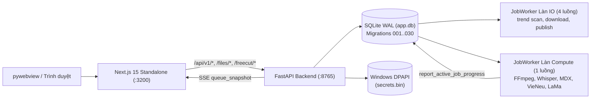

# Tài liệu Tổng kết Bàn giao Kỹ thuật — Video Creator V2

- **Nhánh bàn giao**: `v2` (phiên bản `2.0.0`, trạng thái cây thư mục sạch, chưa push remote)
- **Tài liệu đặc tả gốc**: `docs/video-creator-v2-spec.md`
- **Bộ cài Offline**: `installer/dist/VideoCreatorV2Setup.exe` (**596.1 MB**, SHA-256: `0b8b45c6328049ef56c504fa0c7935e6dea536ca3d91dc34caa9a5c5d3c9622d`)

---

## 1. Lịch sử 6 Commit Bàn giao (`R1 → R6`) trên Nhánh `v2`

| Giai đoạn | Commit | Nội dung chính |
|---|---|---|
| **R1** | `90370f7` | Gỡ sạch đường dẫn cá nhân (`ADMIN`/`iCast`), đồng bộ version `2.0.0`, ẩn `/lipsync` khỏi menu, thêm cờ minh bạch `simulation_flags` + `SimulationBadge`, tự backup `pre-restore-*.vcx` trước khi khôi phục. |
| **R2** | `3d7e0b2` | Danh mục 8 model CPU có URL + SHA-256 thật (`028_v2_models_catalog_v2.sql`), trình tải `.part` HTTP Range + mirror R2 + bắt buộc chạy `verify_model_smoke_test` trên CPU trước khi gán `status='ready'`. |
| **R3** | `e6c3d35` | Dây chuyền Việt hóa / Reup AI thật trên CPU: tách nhạc `MDX-Net`, OCR chữ cứng `RapidOCR` + xóa chữ `LaMa ONNX` / `boxblur`, chép lời `Faster-Whisper`, phân biệt người nói `3D-Speaker ONNX`, dịch AI `translator` + dự phòng `NLLB-200`, lồng tiếng `Edge TTS` & nhân bản giọng `VieNeu-TTS v3 Nano` (Quyết định 7c). |
| **R4** | `d01be28` | Giọng Kênh MC thu trực tiếp 5–10s có xác nhận đồng ý (`channel_voices.py`), tách nền nhân vật `rembg` (`u2net_custom`) thật, avatar Host A/B phát sáng theo đúng lượt nói trong Podcast Studio. |
| **R5** | `3f6b59f` | Toàn bộ trang Studio chuyển sang render bất đồng bộ `sync: false` + thanh tiến trình SSE `JobProgressBanner`; tạo `pipeline/assembly.py` (đưa import `_private` xuyên module về `0`), tách gói `pipeline/localize/` và `autopilot/`, gom dò cổng/runtime về `paths.py`, bật ESLint 9 thật. |
| **R6** | `4974efd` | Đóng gói bộ cài Windows `.exe` độc lập 100% offline: ghim SHA-256 cho Python 3.11.18, Node 24 LTS, FFmpeg/FFprobe, `yt-dlp.exe`, `uv.exe`, nhúng FreeCut (MIT) + `.venv` khả di dùng `venvlauncher.exe` chuẩn; vượt qua bài test `PATH=""` rỗng. |

---

## 2. Kiến trúc Tổng thể & Luồng Dữ liệu

### 2.1. Kiến trúc Runtime Desktop & Hàng đợi 2 Làn



### 2.2. Dây chuyền AI CPU của Studio Việt hóa (`/localize`)


---

## 3. Bản đồ Cấu trúc Mã nguồn

### 3.1. Lõi hệ thống & Hạ tầng (`src/videocreator/`)
- **Điểm vào & Quản lý tiến trình**: `__main__.py` (khóa đơn phiên `SingleInstanceLock`, tự động chọn cổng trống, bật Uvicorn + Next.js standalone + `pywebview`), `app.py`.
- **Đường dẫn & Dò tìm Runtime tập trung**: `paths.py` (`AppPaths`, `_resolve_repo_root`, `find_ffmpeg_binary`, `find_node_runtime`, `find_python_runtime`, `find_yt_dlp_command`, `find_uv_binary`, `is_port_available`, `pick_available_port`).
- **Cấu hình, AI Router & Bảo mật**: `config.py`, `config_ai.py`, `ai/router.py` (vai trò `vision`, `writer`, `checker`, `studio`, `translator`, xoay vòng Key Pool), `secrets_store.py` + `backup_vcx.py`.
- **Hàng đợi bất đồng bộ & Tiến trình SSE**: `jobs.py`, `job_store.py` (`ContextVar` `report_active_job_progress`), `job_handlers.py`.
- **Quản lý Model CPU nội bộ**: `models_manager.py` (tải HTTP Range `.part`, đối chiếu SHA-256, mirror failover, smoke test thật trên CPU).

### 3.2. Các Gói Pipeline & Studio (`src/videocreator/pipeline/` & `tts/`)
- **Hàm lắp ráp dùng chung (0 `_private` import xuyên module)**: `pipeline/assembly.py` (`load_shot_source`, `save_render_cache`, `count_workspace_shots`, `ensure_full_ai_canvas_shot`, `render_styled_still_png`, `concat_podcast_turns_padded`).
- **Gói Localize / Reup (`pipeline/localize/`)**:
  - `project.py` — CRUD, kiểm tra `content_policy` & Quyết định 7c.
  - `extract.py` — điều phối MDX-Net + OCR/Whisper + Diarization + Dịch.
  - `segments.py` — cắt cảnh, anti-dup, che mờ/xóa chữ cứng LaMa ONNX hoặc tráo shot thật.
  - `voice.py` — chọn giọng theo `speaker_id`, kiểm tra đường dẫn mẫu clone nội bộ dự án & nghe thử từng câu.
  - `render.py` — ghép hình, TTS đa người nói, trộn BGM ducking, ASS karaoke, `-14 LUFS` & QC.
- **Các mô-đun AI CPU chuyên trách**: `audio_sep.py`, `ocr_hardsub.py`, `diarization.py`, `translate_vi.py`, `channel_voices.py`, `tts/synthesizer.py`.
- **Các Studio chuyên biệt khác**: `podcast_studio.py`, `novel_studio.py`, `news_studio.py`, `characters.py`, `batch_studio.py`, `editor.py`, `workflow_engine.py`, `lipsync_studio.py`, và gói `autopilot/` (`sources.py`, `rules.py`).

### 3.3. Tầng API, Giao diện Next.js 15 & Bộ cài
- **API v1 REST + SSE**: `src/videocreator/api/v1/` (15 file router tách theo miền nghiệp vụ).
- **Frontend Next.js 15 App Router**: `web-next/src/` (`AppShell.tsx`, `JobProgressBanner.tsx`, `SimulationBadge.tsx`, cấu hình lint `web-next/eslint.config.mjs`).
- **Đóng gói Windows Offline**: `installer/stage_bundle.ps1`, `installer/videocreator.iss`, `installer/post_install.ps1`, `installer/post_install.cmd`, `installer/launch.vbs`.

---

## 4. Các Ràng buộc Kỹ thuật Sống còn (Đọc kỹ trước khi Refactor)

1. **TUYỆT ĐỐI KHÔNG gỡ ghim phiên bản `onnxruntime`, `ctranslate2`, `setuptools` và `numpy` trong `pyproject.toml`**:
   - Trên Windows 10 Enterprise LTSC / máy văn phòng có `C:\Windows\System32\msvcp140.dll` bản cũ (`< 14.40`), các wheel biên dịch bằng MSVC VS 2022 17.10+ (`onnxruntime >= 1.21` hoặc `ctranslate2 >= 4.6`) bị **Access Violation (`0xC0000005`)** tại `_Mtx_init_in_situ`.
   - `ctranslate2 4.5.0` import `pkg_resources` nên phải giữ `setuptools>=70.0,<81.0`.
2. **Cơ chế `.venv` khả di trong Bộ cài Offline (`installer/stage_bundle.ps1`)**:
   - Launcher `.venv\Scripts\python.exe` mặc định do `uv` tạo trên Windows nhúng cứng đường dẫn máy build (`C:\Users\ADMIN\...`).
   - `stage_bundle.ps1` dùng `--link-mode copy --no-editable --no-compile-bytecode` và thay bằng `runtime\python\Lib\venv\scripts\nt\python.exe` (`venvlauncher.exe` chuẩn của CPython). Khi cài hoặc di dời thư mục, `post_install.ps1` và `launch.vbs` tự ghi lại `home = <AppRoot>\runtime\python` (UTF-8 không BOM) không cần mạng.
3. **Bảo vệ RAM máy 8 GB & Cắt khoảng lặng giọng đọc**:
   - Làn `compute` luôn giữ `compute_concurrency = 1`; mọi mô hình đều giải phóng session + `gc.collect()` trong `finally`.
   - `trim_voice_silence` trong `tts/synthesizer.py` cắt khoảng lặng đầu/cuối bằng NumPy PCM (`-45 dBFS`), không dùng FFmpeg `silenceremove=stop_periods=1` để tránh cắt cụt câu tiếng Việt sau dấu phẩy/nhịp nghỉ ngắn.

---

## 5. Quy ước Bất biến về Nghiệp vụ & Minh bạch AI

1. **Ba cấp `content_policy` theo Workspace**:
   - `strict_footage`: Chỉ dùng footage/shot quay thật; cấm `reup_vi`, `hybrid_remix`, `novel`, `lipsync`, và cấm nhân bản giọng gốc; khi cắt shot sản phẩm thật phải giữ `allow_creative_filters=False` (`BR-PRD-01`).
   - `hybrid_remix`: Cho phép tráo shot sản phẩm thật vào video remix và dùng các Studio bán tự động.
   - `full_ai`: Cho phép đầy đủ Reup Việt hóa, tạo nền b-roll tự động và nhân bản giọng (khi đã xác nhận đồng ý).
2. **Quyết định 7c (Nhân bản giọng gốc)**: Mặc định tắt; chỉ bật ở `hybrid_remix`/`full_ai` khi `clone_consent_confirmed=true`; ghi `audit_log`; file mẫu `.wav` người nói khóa chặt trong `media/localize/proj_<id>/speakers/`.
3. **Minh bạch chế độ dự phòng (`simulation_flags`)**: Mọi đường dự phòng (`tts_tone_placeholder`, `offline_nllb_translation`, `audio_sep_midside_fallback`, `cutout_colorkey_fallback`, `ocr_inpaint_delogo_fallback`, `ai_image_canvas_placeholder`, `lipsync_waveform_preview`) đều phải lưu DB và hiển thị qua `SimulationBadge`.

---

## 6. Danh mục Điểm nóng & Đề xuất Refactor Tiếp theo

### Ưu tiên 1 — Tách nhỏ các file Backend ở ngưỡng 600–850 dòng
- `src/videocreator/models_manager.py` (845 dòng) → tách thành gói `models/` (`catalog.py`, `downloader.py`, `smoke.py`, `asr.py`).
- `src/videocreator/tts/synthesizer.py` (773 dòng) → tách `edge_engine.py`, `vieneu_engine.py`, `audio_fit.py`, giữ `synthesizer.py` làm facade mỏng.
- `src/videocreator/autopilot/rules.py` (677 dòng) → tách `crud.py` và `runner.py`.
- `src/videocreator/api/v1/routes_resources.py` (644 dòng) & `routes_production.py` (568 dòng) → tách theo từng tài nguyên (`workspaces`, `products`, `footage`, `videos`).

### Ưu tiên 2 — Tách Component cho 2 trang Next.js lớn nhất
- `web-next/src/app/localize/page.tsx` (793 dòng) → tách `CreateLocalizeForm`, `SpeakerVoicePanel`, `BilingualSegmentsTable`, `HardsubBoxPreview`, `VoiceCloneConsentModal`.
- `web-next/src/app/settings/page.tsx` (684 dòng) → tách `AiKeysPoolTab`, `LocalModelsManagerTab`, `BackupRestoreTab`.

### Ưu tiên 3 — Dọn tầng UI Jinja2/HTMX cũ (V1) & Nâng cấp Ảnh AI thật
- Khi chốt chuyển 100% sang Next.js Studio UI, có thể nâng cấp các bài test V1 cũ sang `/api/v1/*` rồi xóa `src/videocreator/api/routes_*.py` (ngoài `v1/`) và `src/videocreator/web/templates/`.
- Nối `characters.py::generate_ai_image` với Gemini Imagen / Flux API thật khi có mạng thay cho khung nền màu định sẵn (`ai_image_canvas_placeholder`).

---

## 7. Sổ tay Lệnh Kiểm tra & Đóng gói Nhanh

```powershell
Set-Location c:\Users\ADMIN\video-creating
$env:PYTHONIOENCODING = "utf-8"

# 1. Đồng bộ môi trường dev (luôn giữ --extra dev)
uv sync --extra dev

# 2. Lint & Build giao diện Next.js 15 Standalone
Push-Location web-next
$env:PATH = "c:\Users\ADMIN\video-creating\runtime\node;$env:PATH"
npm run lint
npm run build
Pop-Location

# 3. Kiểm thử local chuẩn (257 passed)
.venv\Scripts\pytest.exe -m local -q

# 4. Kiểm thử suy luận AI CPU thật (4 passed)
.venv\Scripts\pytest.exe -m models -v

# 5. Đóng gói lại bộ cài Offline VideoCreatorV2Setup.exe
powershell -ExecutionPolicy Bypass -File installer\stage_bundle.ps1 -IncludeRuntimes
& "$env:LOCALAPPDATA\Programs\Inno Setup 6\ISCC.exe" installer\videocreator.iss
```
